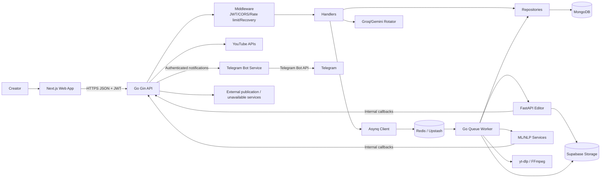
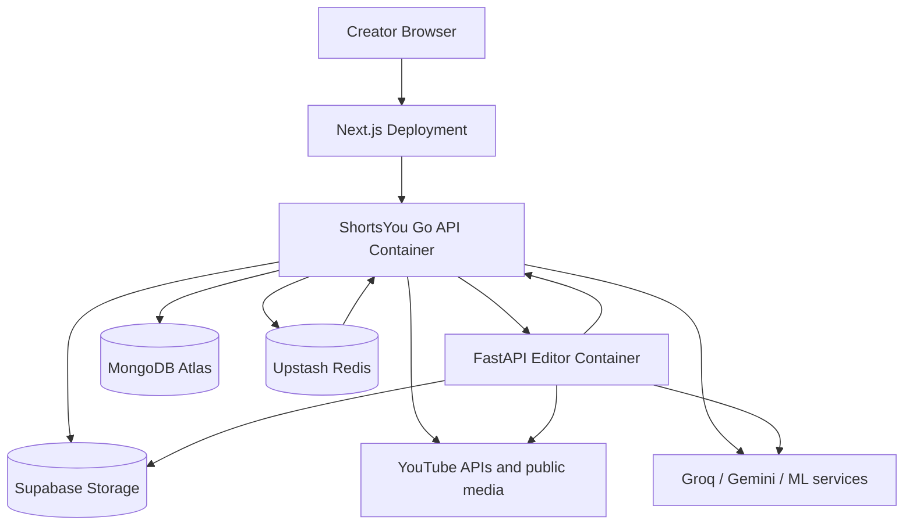
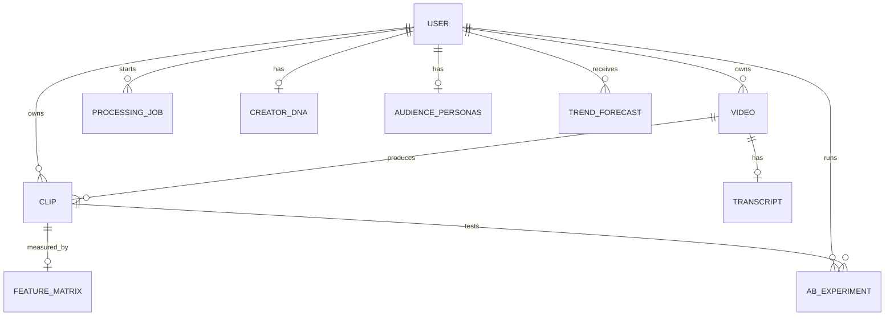
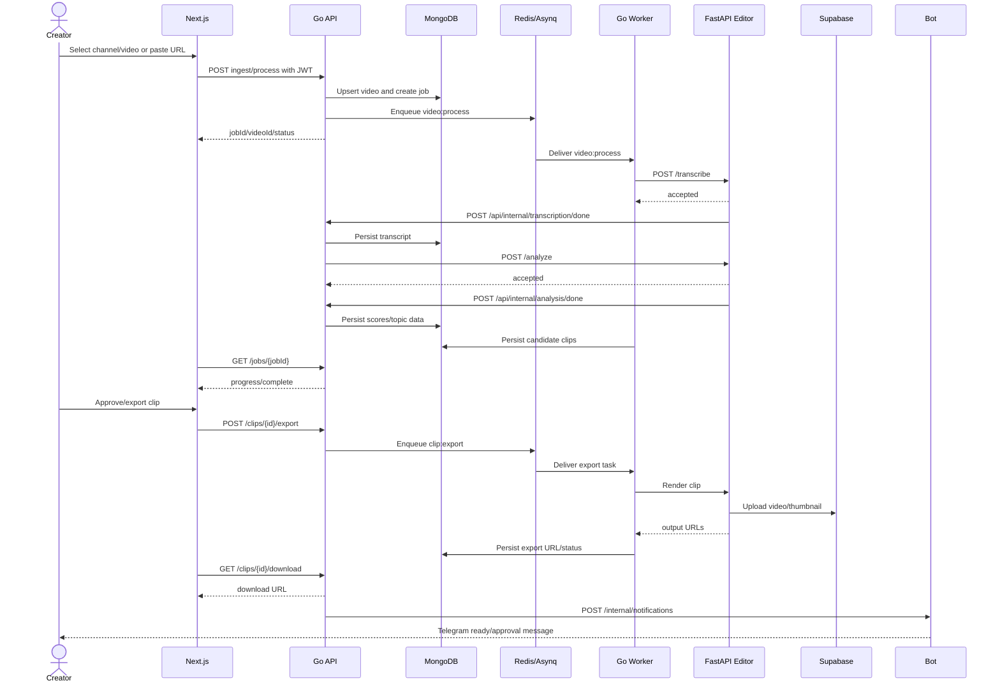
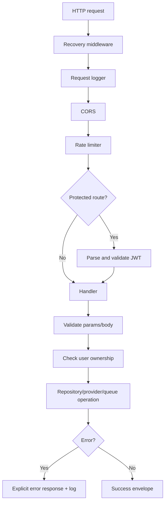
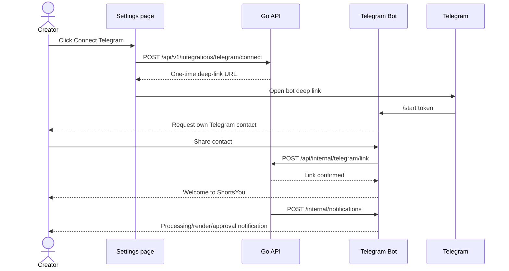

# ShortsYou Architecture, System Design, Data Flow, and Control Flow

## 1. Scope and evidence

This design is derived from the available Go backend, Next.js frontend, and
FastAPI editor source. It is an implementation-grounded design, not a claim
about unavailable Mayank or Sammyu repositories. Those systems are shown as
external boundaries only.

## 2. Architectural style

ShortsYou is a distributed, service-oriented application with a modular
monolithic Go API and a specialized Python media worker:

- **Presentation layer:** Next.js/React web app.
- **API/application layer:** Go + Gin HTTP API.
- **Domain/application modules:** video ingestion, clips, swipe review,
  analytics, auth, channels, AI tools.
- **Persistence layer:** MongoDB repositories.
- **Asynchronous execution:** Redis + Asynq client/worker.
- **Media/AI compute boundary:** FastAPI editor and ML service contracts.
- **Object storage boundary:** Supabase Storage.
- **External data/providers:** YouTube, Google OAuth, Groq, Gemini.

The Go server is intentionally the coordination boundary. Expensive and
failure-prone work is moved to queues or external workers rather than blocking
the browser request.

## 3. Logical component diagram

## 4. Deployment view

## 5. Module responsibilities

### Web

The web app owns presentation state and client-side request orchestration. It
does not own product truth. It sends JWT-authenticated requests, displays
envelopes, and polls asynchronous jobs.

### Go HTTP server

The Go server:

- validates configuration at startup;
- initializes MongoDB, Redis, repositories, clients, and queue workers;
- exposes public, protected, internal, and documentation routes;
- authenticates creators with Google OAuth and JWT;
- enforces user ownership in handler/repository operations;
- creates and updates domain records;
- queues long-running work;
- calls LLM/ML/editor services;
- receives internal callbacks and advances persisted state.

### Queue worker

Asynq tasks provide retries and delayed execution:

- `video:process` handles the video intelligence pipeline;
- `clip:export` handles media export;
- `clip:collect_analytics` is scheduled after publication;
- `user:retrain_cpep` retrains creator prediction data.

### Editor and ML services

The editor service is compute-heavy and stateless with respect to product
workflow. It receives source URLs or transcript payloads, performs processing,
uploads artifacts, and returns/calls back with results. The Go service remains
responsible for associating results with users, videos, clips, and jobs.

### Telegram Assistant

The Telegram service is a notification and review adapter. It does not own
ShortsYou creator identity. The Go API issues a short-lived link token; the bot
confirms the Telegram user's contact and calls the internal link endpoint. Go
stores the association and sends server-to-server notification webhooks back to
the bot service.

## 6. Data model and relationships

### Core entities

| Entity | Key responsibilities |
|---|---|
| User | Google identity, email/name/profile, channel association, token metadata. |
| Video | Source metadata, YouTube identity, owner, processing status, source URLs. |
| Transcript | Word timestamps, segments, filler words, silence gaps, language. |
| Clip | Time bounds, hook, scores, edit settings, status, export URL, publication. |
| ProcessingJob | User-scoped asynchronous status, progress, error, completion. |
| FeatureMatrix | Features and performance band used for scoring/analytics. |
| CreatorDNA | Creator topics, features, style, and emotional range. |
| Persona | Audience terms, sentiment, share, and engagement. |
| TrendForecast | Topic prediction, confidence interval, similarity, peak date/score. |
| ABExperiment | Original/generated hooks, CTR, lift, and completion. |

## 7. Primary end-to-end data flow

## 8. Flow of control

### 8.1 Startup control flow

1. `cmd/server/main.go` calls configuration loading.
2. Configuration loads `.env` and environment variables, applies defaults, and
   validates required values.
3. MongoDB connects, pings, and creates application indexes.
4. Redis connects.
5. The Asynq client and worker are initialized.
6. Repositories are constructed over MongoDB.
7. OAuth, LLM rotation, ML, storage, and job dependencies are constructed.
8. Queue handlers are registered for each task type.
9. The worker starts in a goroutine.
10. The Gin server is created, routes are registered, and HTTP serving starts.
11. SIGINT/SIGTERM initiates graceful HTTP shutdown and worker stop.

### 8.2 Synchronous request control flow

### 8.3 Video processing control flow

1. The creator requests sync, ingest, public-video processing, generate, or
   auto-create.
2. The handler validates the request and identifies the authenticated user.
3. The video repository upserts or loads the video.
4. A processing job is created.
5. A `video:process` task is enqueued.
6. The worker downloads or obtains media metadata and invokes transcription.
7. The editor/ML service returns an immediate accepted response.
8. The callback endpoint persists transcript data.
9. Analysis is requested using the transcript.
10. The analysis callback persists scoring/topic information.
11. The worker/handler creates candidate clips and updates job progress.
12. The frontend polls until success or error.

### 8.4 Clip export control flow

1. The creator approves or selects a clip.
2. The frontend requests export.
3. The handler validates clip ownership and queues `clip:export`.
4. The worker loads clip bounds, transcript/caption words, edit settings, and
   source media.
5. The editor composes the short with FFmpeg and configured services.
6. The editor uploads the rendered MP4 and thumbnail to Supabase.
7. The worker persists output URLs and completion status.
8. The creator requests a download URL.
9. The creator may mark the clip as published.
10. A delayed analytics collection task may be scheduled.

### 8.5 Telegram connection and notification control flow

## 9. Editor processing pipeline

The editor's transcription path first tries Groq Whisper with configured key
rotation. If cloud transcription does not produce words, it falls back to local
OpenAI Whisper when installed. This is a resilience path, not a guarantee that
every production deployment has the local model available.

## 10. Failure handling and resilience

### Startup failures

Missing required configuration, MongoDB failure, Redis failure, index creation
failure, or queue initialization failure prevents normal startup. This is
preferable to running with an invalid persistence or authentication boundary.

### Request failures

Recovery middleware prevents a panic from taking down the process. Handlers
should return explicit status/error responses. Rate limiting and JWT checks
protect the public surface.

### Background failures

Asynq retries process/export/analytics/retraining tasks up to the configured
retry limit. Job records should expose a terminal error so the frontend does not
poll indefinitely.

### Callback failures

Callbacks must be authenticated and retriable. Since external producers may
retry after receiving a network failure, callback handlers should tolerate
duplicate delivery by using job/video IDs and state checks.

### Telegram delivery failures

Telegram delivery is best effort. A failed notification is logged by the Go
service but does not mark the underlying video or clip job failed. Creators can
always recover authoritative state from the website.

### Provider failures

- Groq keys rotate on failure/rate limiting.
- Editor transcription falls back to local Whisper.
- YouTube download uses multiple client strategies and may use a configured
  proxy in blocked datacenter environments.
- Supabase and external ML failures must leave the associated job/clip in an
  observable failed or retryable state.

## 11. Security design

- Google OAuth is the identity acquisition mechanism.
- JWT is the browser-to-Go API authentication mechanism.
- Internal API keys authenticate service callbacks.
- CORS restricts allowed browser origins.
- Rate limiting applies globally at the router layer.
- User-scoped repository queries are required for videos, clips, jobs, and
  analytics.
- Secrets are environment variables and must not be logged or committed.
- Production callback URLs must be public HTTPS endpoints.
- Debug configuration is disabled in production.

Security hardening still required for a production review:

1. Confirm admin role enforcement on `/api/v1/admin/key-health`.
2. Confirm callback replay/idempotency behavior.
3. Confirm Supabase URL visibility and object access policy.
4. Confirm YouTube terms, source-content rights, and publication permissions.
5. Confirm external services use least-privilege keys and network controls.

## 12. Observability design

The Go service uses structured logging via zerolog and logs startup,
dependency readiness, queue worker lifecycle, HTTP activity, and failures.
Operational dashboards should correlate:

- request ID or trace ID;
- user ID;
- video ID;
- clip ID;
- job ID;
- queue task ID;
- external callback attempt.

Recommended metrics include queue depth, task retry count, processing latency,
transcription latency, callback latency, render latency, provider error rate,
and export success rate.

## 13. Consistency and ownership rules

1. MongoDB is the product state source of truth.
2. Redis is execution state, not durable product state.
3. Supabase stores bytes and media URLs, not workflow ownership.
4. The browser may cache data but must refresh job/clip state from Go.
5. External ML results are accepted only after authentication and association
   with the expected job/video/user.
6. A render artifact is not considered usable until its URL and status are
   persisted by Go.

## 14. Open boundaries and assumptions

The following are intentionally not invented:

- Mayank repository internals, endpoints, schemas, and deployment.
- Sammyu repository internals, endpoints, schemas, and deployment.
- The final external social publishing provider.
- Whether every analytics callback producer is the same FastAPI editor or a
  separate service.
- Production infrastructure details beyond the Docker Compose and runtime
  configuration visible in the repositories.

Before calling the architecture complete, obtain the missing repositories or
written API contracts and add them as explicit components, sequence diagrams,
failure paths, and data ownership rules.

## 15. Design recommendations

1. Generate client types from the running `/openapi.json` and keep this
   documentation synchronized with it.
2. Add explicit schema/version fields to internal callbacks.
3. Add idempotency keys to ingest, export, and callback operations.
4. Store provider attempts and terminal error reasons on jobs.
5. Separate “approved”, “exported”, and “published” state transitions clearly.
6. Add a dedicated admin authorization check instead of relying only on JWT.
7. Use signed or policy-controlled storage URLs where media is private.
8. Add distributed tracing across Go, queue, editor, callbacks, and storage.
9. Document a single canonical port/configuration contract for local Docker and
   cloud deployment.
10. Treat unavailable team repositories as contract dependencies, not implicit
    shared code.
11. Keep the bot service key separate from the Telegram bot token and rotate
    both independently.
